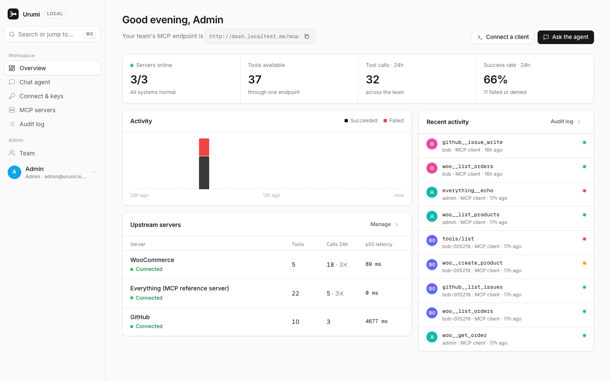
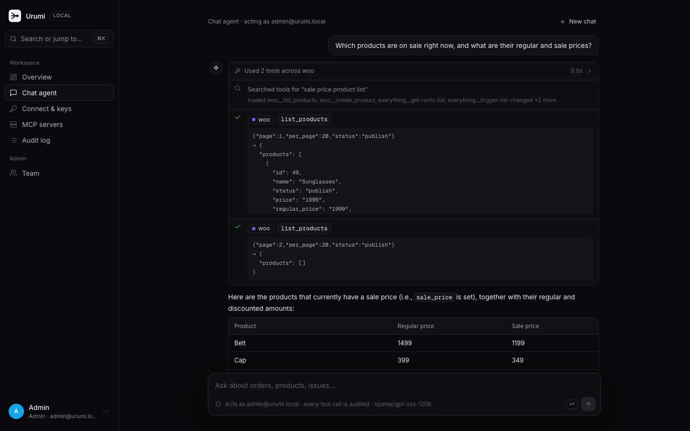
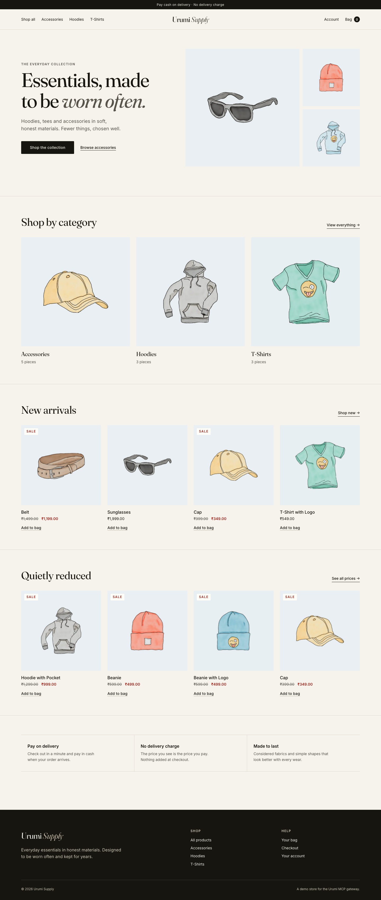
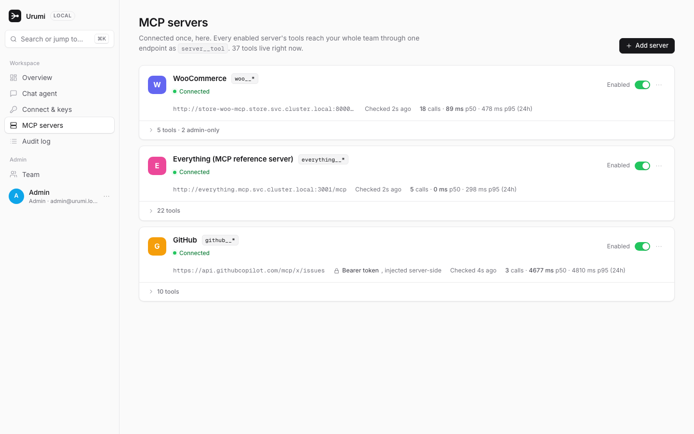
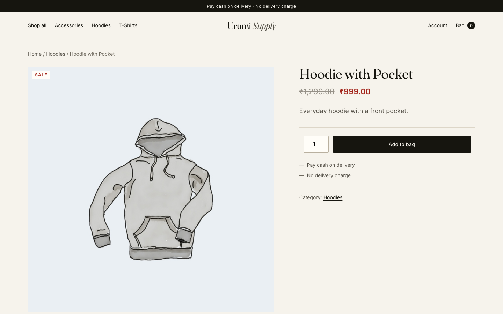
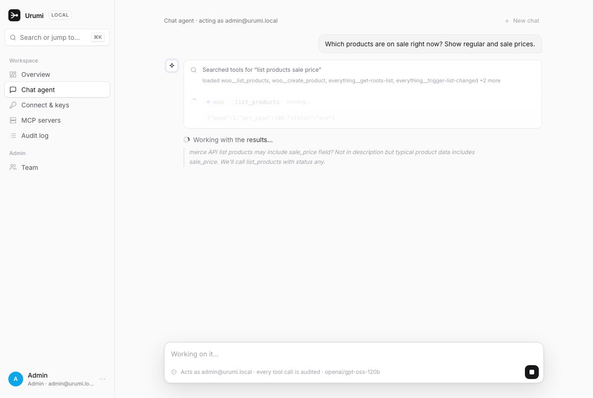
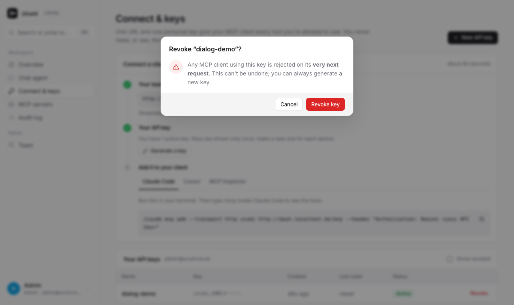

# Urumi: WooCommerce hosting with a team MCP gateway, on Kubernetes

A WooCommerce store, an MCP server for it, and a **team MCP gateway** with a React dashboard and a streaming chat agent, all running on Kubernetes and installed with Helm.

An admin connects MCP servers once in the dashboard. Every team member then gets **all** of those tools through **one MCP endpoint and one personal API key**, from Claude Code, Cursor, MCP Inspector, or the chat agent built into the dashboard. Members never see the upstream servers' credentials, and every tool call is audited.

**Live deployment** (Azure VM, k3s, Let's Encrypt): [store](https://store.4.194.18.91.sslip.io) · [dashboard](https://dash.4.194.18.91.sslip.io), built from the same charts with `values-prod.yaml`. `make vps-test` runs the full Definition-of-Done check against it: **24/24**.

<p>
  
  
</p>
<p>
  
  
</p>

**Further reading:** [System design and tradeoffs](docs/design.md) · [Threat model](docs/threat-model.md) · [What broke and what I learned](docs/lessons.md) · [Upgrades and rollback](docs/upgrades.md)

---

## Contents

- [Architecture](#architecture)
- [Run it locally](#run-it-locally)
- [Using it](#using-it)
- [Production on a VPS (k3s)](#production-on-a-vps-k3s)
- [Upgrades and rollback](#upgrades-and-rollback)
- [Security demo: a malicious MCP server](#security-demo-a-malicious-mcp-server)
- [Make targets](#make-targets)
- [Repository layout](#repository-layout)
- [Bonus and stand-out items](#bonus-and-stand-out-items)

---

## Architecture

```
                     Claude Code / Cursor (user B)          Browser (user A)
                                │ Bearer urumi_…                 │ session cookie
                                ▼                                ▼
 ┌────────────────────── Traefik Ingress ── dash.<domain> ──────────────────┐   store.<domain>
 │  ns: gateway                                                             │          │
 │   /mcp ─► Gateway (2 replicas, FastAPI + MCP SDK) ◄─ /api ── Dashboard   │          │
 │            │  auth → resolve "slug__tool" → permission → route → audit   │          │
 │            │  chat agent = MCP client of its own /mcp, as the user       │          │
 │            ├─ Postgres: users, hashed keys, servers, encrypted creds, audit log      │
 └────────────┼─────────────────────────────────────────────────────────────┘          │
              │ MCP (Streamable HTTP), credential injected server-side                 │
   ┌──────────┼───────────────────────┬──────────────────────────────┐                 │
   ▼ ns: store│                       ▼ ns: mcp                      ▼ internet         ▼
 woo-mcp ─► WordPress + WooCommerce ◄─┘ "everything" reference     GitHub's hosted   Shoppers
 (ClusterIP only)   │                   server (kill-the-pod demo)  MCP server (PAT)
                 MariaDB
```

| Layer | What it is | Code |
|---|---|---|
| Store | WordPress 7.1 + WooCommerce + MariaDB with a custom "Urumi Supply" theme, set up by a WP-CLI Job | [`charts/store`](charts/store), [`charts/store/theme`](charts/store/theme) |
| WooCommerce MCP server | 5 tools over Streamable HTTP, written from scratch | [`services/woo-mcp`](services/woo-mcp) |
| Gateway | Aggregating MCP server, REST API, streaming chat agent | [`services/gateway`](services/gateway) |
| Dashboard | React (Vite) app with light and dark themes, served by nginx | [`dashboard`](dashboard) |
| Other upstreams | MCP reference server (in-cluster), GitHub's hosted MCP server (needs a token) | [`charts/everything`](charts/everything), [`charts/gateway/values.yaml`](charts/gateway/values.yaml) |

**How a tool call travels** (details in [docs/design.md](docs/design.md)):

1. A client POSTs a JSON-RPC `tools/call` for `woo__list_orders` to `/mcp` with its API key.
2. The gateway hashes the key and looks it up (one indexed query), or rejects with 401.
3. It splits the name into server `woo` and tool `list_orders`, then checks the server is enabled, healthy and not quarantined, and that the caller's role may use the tool.
4. It opens an MCP session to `woo-mcp` inside the cluster, adding woo's own credential, with a 20 s timeout.
5. woo-mcp calls the WooCommerce REST API over the internal Service (OAuth 1.0a signed), and WooCommerce reads MariaDB.
6. The result comes back unchanged, and the call is written to the audit log with user, server, tool, duration and outcome.

---

## Run it locally

**You need:** Docker Desktop (give it 8 GB of memory), `k3d`, `helm` (v3 or v4), `kubectl`, `make`, Python 3.11+.

```bash
brew install k3d helm kubectl
```

**1. Secrets (never committed).** Copy the template and fill in an LLM key for the chat agent and, optionally, a GitHub token for the GitHub upstream:

```bash
cp charts/gateway/secrets.example.yaml charts/gateway/secrets.local.yaml
```

```yaml
llm:
  apiKey: "gsk_…"                  # any OpenAI-compatible API; Groq's free tier works
upstreams:
  credentials:
    GITHUB_TOKEN: "github_pat_…"   # fine-grained PAT, Issues: read & write on one repository
```

Without a GitHub token the GitHub server is simply not registered. Without an LLM key the chat agent says so, and everything else works.

**2. Create the cluster and install everything:**

```bash
make cluster
```

```bash
make up
```

`make up` builds the five images, imports them into k3d (no registry needed locally) and installs three Helm releases:

| Release | Namespace | Contents |
|---|---|---|
| `store` | `store` | WordPress, MariaDB, woo-mcp, setup Job, theme |
| `everything` | `mcp` | the MCP reference server |
| `gateway` | `gateway` | gateway, Postgres, dashboard |

The first run takes a few minutes while WordPress, WooCommerce, the theme and the demo catalogue are set up.

**3. Open it:**

| What | URL | Login |
|---|---|---|
| Storefront | http://store.localtest.me | — |
| WooCommerce admin | http://store.localtest.me/wp-admin | `admin` / `make store-password` |
| Dashboard | http://dash.localtest.me | `admin@urumi.local` / `make admin-password` |

**Local domains.** `*.localtest.me` is public DNS that resolves to `127.0.0.1`, so no `/etc/hosts` edits are needed. k3d maps ports 80/443 on your machine to Traefik inside the cluster, which routes by hostname. On a VPS the same Ingress objects use the domains in `values-prod.yaml`.

**4. Check every Definition-of-Done item automatically:**

```bash
make test-dod
```

It creates two fresh users and runs 24 checks against the live cluster:
- a checkout through the storefront's own cart API;
- the chat agent as user A;
- an MCP client as user B;
- revocation, disabling a server, killing an upstream pod;
- audit attribution.

Add `ARGS=--skip-llm` to skip the LLM calls. To clear test data afterwards, run `make demo-reset`.

---

## Using it

### Place an order
Open http://store.localtest.me, add something to the bag, and check out with **Cash on delivery**. The order appears in WooCommerce → Orders, and the chat agent can find it ("What orders came in today?").



### Invite a teammate and get an API key
1. Dashboard → **Team → Invite teammate** creates a one-time invite link (valid 7 days).
2. The teammate opens it and sets a password.
3. The Overview page shows them a **Get started** checklist. **Connect & keys → New API key** shows the key once, ready-to-paste client commands with the key filled in, and copy buttons. The key is stored only as a SHA-256 hash.

Press **⌘K** anywhere in the dashboard for the command menu: jump to a page, generate a key, add a server, invite someone, switch to dark mode.

### Connect an external MCP client
The gateway URL is `http://dash.localtest.me/mcp` (Streamable HTTP). With a key:

```bash
claude mcp add --transport http urumi http://dash.localtest.me/mcp --header "Authorization: Bearer urumi_…"
```

Cursor (`~/.cursor/mcp.json`):

```json
{ "mcpServers": { "urumi": { "url": "http://dash.localtest.me/mcp", "headers": { "Authorization": "Bearer urumi_…" } } } }
```

MCP Inspector: run `npx @modelcontextprotocol/inspector`, choose transport **Streamable HTTP**, enter the URL above, and add the header `Authorization: Bearer urumi_…`.

Tools appear as `<server>__<tool>`, for example `woo__list_orders` and `github__issue_write`. A two-server prompt to try: *"Summarise today's orders and open a GitHub issue in OWNER/REPO with the summary."*

### Use the chat agent
Dashboard → **Chat agent**. The agent:
- acts as the signed-in user, calling tools through the gateway's own `/mcp` endpoint with a short-lived token;
- **streams its work as it happens**: tool searches, each tool call with a spinner and its duration, the model's reasoning, then the answer word by word;
- lists its calls in the audit log under your name with source **Chat agent**.

<p>
  
  
</p>

### Manage servers, people and permissions
- **MCP servers:**
  - status for each server (Connected, Unreachable with the reason, Disabled, Quarantined);
  - an enable switch and a ⋯ menu (check now, edit, remove);
  - every tool with its read/write kind, plus a per-tool **Everyone / Admins** access control.
- **Team:** roles, invites, and each member's API keys.
- **Audit log:** every call, filterable by search, outcome, source and server. Click a failed row for the error.

---

## Production on a VPS (k3s)

The deployment at the top of this page is an Azure B2as_v2 VM (2 vCPU, 8 GB, Ubuntu 24.04) running single-node k3s. It uses the same charts as local, with `values-prod.yaml`. What changes, all through Helm values:

| | Local (`values-local.yaml`) | VPS (`values-prod.yaml`) |
|---|---|---|
| Domains | `store.localtest.me`, `dash.localtest.me` | `store.<IP>.sslip.io`, `dash.<IP>.sslip.io` (sslip.io resolves to the IP in the name, so no DNS setup); with a real domain, an A record per host |
| TLS | none | cert-manager + Let's Encrypt (HTTP-01), `cert-manager.io/cluster-issuer` annotation; http → https redirect in Traefik |
| Images | built locally, imported with `k3d image import` | `ghcr.io/nrg2005/urumi-*`, built for amd64 + arm64 by [CI](.github/workflows/images.yml), `pullPolicy: Always` |
| Storage | `local-path`, 1–2 Gi | `local-path` (k3s), 5 Gi; swap the storage class for a cloud disk on a managed cluster |
| Secrets | generated by Helm; LLM/GitHub keys from `secrets.local.yaml` | same mechanism; the file lives only on the machine running `helm` |
| Cookies | plain | `Secure` (set automatically when the public URL is https) |

**How it was set up.** The VM's firewall allows only ports 22, 80 and 443.

1. On the VM, install k3s (it includes Traefik, local-path storage and NetworkPolicy enforcement):

   ```bash
   ssh -i ~/.ssh/urumi-key.pem azureuser@<IP> 'curl -sfL https://get.k3s.io | sudo sh -'
   ```

2. From the laptop, reach the Kubernetes API through an SSH tunnel, so port 6443 is never exposed:

   ```bash
   make vps-kubeconfig vps-tunnel VPS_IP=<IP>
   ```

   ```bash
   export KUBECONFIG=~/.kube/urumi-vps.yaml
   ```

3. Set up TLS: cert-manager, a Let's Encrypt issuer, and an http → https redirect.

   ```bash
   helm repo add jetstack https://charts.jetstack.io
   ```

   ```bash
   helm install cert-manager jetstack/cert-manager -n cert-manager --create-namespace --set crds.enabled=true --wait
   ```

   ```bash
   kubectl apply -f deploy/cluster-issuer.yaml -f deploy/traefik-https-redirect.yaml
   ```

4. Deploy the same three charts with production values (the domains are in `charts/*/values-prod.yaml`), then run the Definition-of-Done check against it:

   ```bash
   make vps-up
   ```

   ```bash
   make vps-test
   ```

The GHCR images are public because the repository is. For a private repository, add an image pull secret.

---

## Upgrades and rollback

Every `make store|gateway|everything` is a `helm upgrade --install`, so each deploy is a numbered release. To see the history and roll back:

```bash
helm history gateway -n gateway
```

```bash
helm rollback gateway <revision> -n gateway
```

Before upgrading the store, take a backup. `helm rollback` restores Kubernetes objects, not data:

```bash
make store-backup
```

**A bad release causes no downtime.** The gateway runs 2 replicas with a rolling update, so a new pod that never becomes ready never replaces the old ones. Tested: 123/123 health probes returned 200 during a failed release and its rollback. See [docs/upgrades.md](docs/upgrades.md).

---

## Security demo: a malicious MCP server

1. Deploy a demo-only server that looks harmless:
   ```bash
   make evil
   ```
2. In the dashboard: **MCP servers → Add server**, URL `http://evil-mcp.mcp.svc.cluster.local:8000/mcp`, slug `weather`.
3. Make it rewrite its tool description with hidden instructions for the model:
   ```bash
   make rugpull
   ```

Within one health check (about 5 s) the gateway notices the changed definition and **quarantines** the server:
- its tools disappear for every client and the chat agent;
- direct calls are refused and audited;
- the dashboard shows what changed, so an admin can approve the new definitions or disable the server.

Remove it with `make evil-down`. Details in the [threat model](docs/threat-model.md).

---

## Make targets

| Target | What it does |
|---|---|
| `make cluster` / `make cluster-down` | create / delete the local k3d cluster |
| `make up` | build all images and install all releases |
| `make store`, `make everything`, `make gateway` | install or upgrade one release (`ENV=prod` for production values) |
| `make images`, `make image-<name>` | build image(s) and import them into k3d |
| `make test-dod` | automated Definition-of-Done check (24 checks) |
| `make demo-reset` | clear test data: users other than the admin, API keys, audit log, orders, products without a photo. Keeps servers, permissions and the catalogue. Asks for confirmation. |
| `make admin-password`, `make store-password` | print generated passwords |
| `make store-backup` | dump the store database to `backups/` |
| `make status` | pods, services, ingresses, volumes and network policies |
| `make evil`, `make rugpull`, `make evil-down` | malicious-server security demo |
| `make vps-kubeconfig`, `make vps-tunnel`, `make vps-up`, `make vps-test` | production VM: fetch kubeconfig, open the API tunnel, deploy, verify |

## Repository layout

```
charts/store          WordPress, MariaDB, WP-CLI setup Job, woo-mcp, NetworkPolicies
charts/store/theme    "Urumi Supply" WooCommerce theme (shipped as a ConfigMap, installed by the Job)
charts/gateway        gateway, Postgres, dashboard, Ingress, Secrets, NetworkPolicies
charts/everything     MCP reference server (in-cluster upstream)
charts/evil-mcp       demo-only malicious server
services/woo-mcp      WooCommerce MCP server (Python, MCP SDK)
services/gateway      app/mcp_gateway.py   the /mcp endpoint and auth middleware
                      app/registry.py      naming, routing, permissions, health checks, quarantine
                      app/upstream.py      the gateway as an MCP client of each upstream
                      app/agent.py         streaming chat agent (an MCP client of /mcp)
                      app/toolsearch.py    tool search for many-tool setups
                      app/auth.py, security.py, api.py, db.py, audit.py
dashboard             React dashboard (src/ui.tsx = design-system components, src/pages/*)
scripts               test_dod.py (automated DoD check), demo-reset.sh
deploy                cert-manager issuer, Traefik https redirect (production only)
docs                  design, threat model, lessons, upgrades, screenshots
```

## Bonus and stand-out items

The multi-store bonus was not attempted; the core came first. Stand-out items:

| Item | Status | Where |
|---|---|---|
| 1. VPS deployment | ✅ live on Azure k3s with Let's Encrypt TLS and http → https redirect; same charts, `values-prod.yaml`; DoD check passes 24/24 against it | [Production on a VPS](#production-on-a-vps-k3s) |
| 2. Tool permissions | ✅ per-tool role (Everyone / Admins only), hidden from lists **and** refused if called directly; applies to the chat agent too | `registry.py`, MCP servers page |
| 4. Many tools | ✅ the chat agent starts with one `search_tools` tool and loads only matching schemas (~5.8k → ~1k tokens per request) | `toolsearch.py`, `agent.py` |
| 6. Security hardening | ✅ see below | `security.py`, `charts/*/templates/networkpolicy.yaml` |
| 7. Scaling | ✅ partial: 2 gateway replicas on stateless Streamable HTTP; no rate limits yet | `charts/gateway/values.yaml` |
| 8. Observability | ✅ partial: per-server calls, failures, p50/p95 latency; a 24 h activity chart; why an upstream is unreachable; every failed call's reason in the audit log | `/api/stats`, Overview and MCP servers pages |
| 9. Upgrades and rollback | ✅ tested zero-downtime failed release and rollback; DB migrations in the setup Job; `make store-backup` | [docs/upgrades.md](docs/upgrades.md) |

Security hardening (#6) in detail:
- SSRF guard on admin-added URLs. It blocks private ranges and cloud metadata, with an allowlist for our own in-cluster namespaces.
- Default-deny NetworkPolicies in every namespace. woo-mcp's outbound traffic is limited to its own WordPress.
- Non-root containers, with read-only root filesystems where possible.
- Upstream credentials encrypted at rest (Fernet).
- Rug-pull quarantine for servers whose tool definitions change.

Beyond the brief:
- **Streaming chat agent:** live tool steps, model reasoning, and the answer token by token.
- **Custom storefront theme**, meeting WCAG AA contrast, with semantic CSS custom properties.
- **Dashboard extras:** light and dark themes, ⌘K command menu, onboarding checklist.
- **Automated Definition-of-Done test** for local and production.
